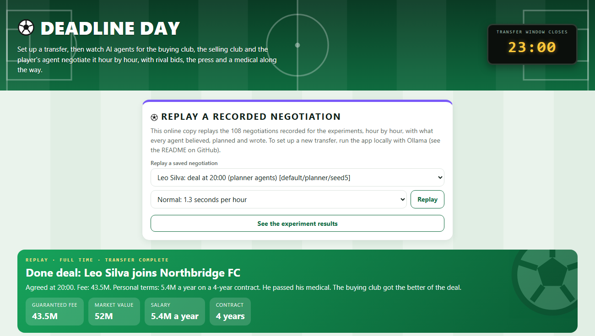
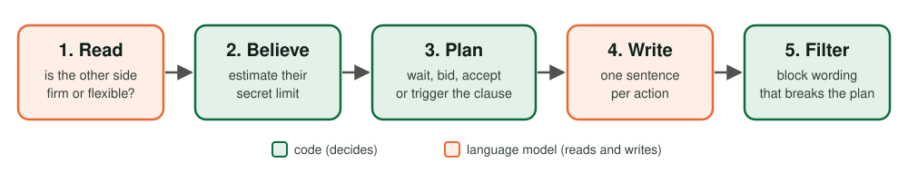
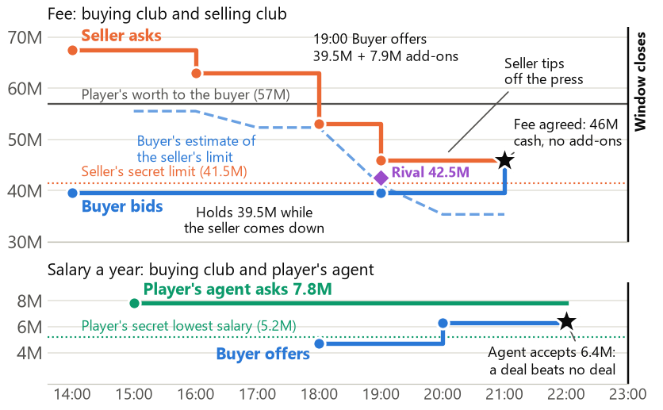
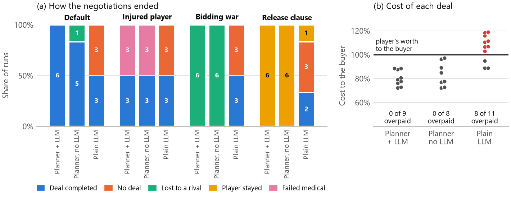
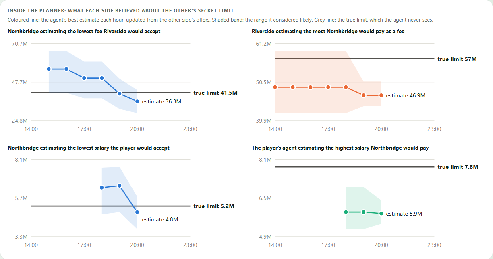
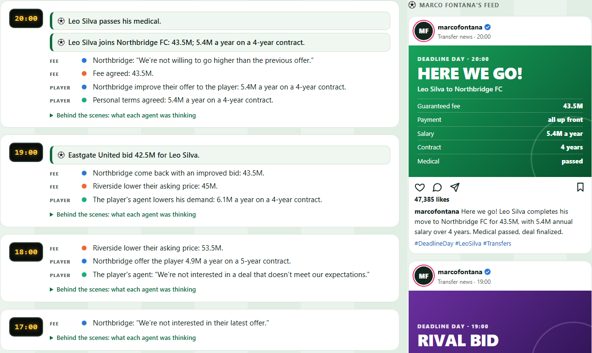

# ⚽ Deadline Day

**Strategic negotiation agents in a simulated football transfer market**

*Code decides, a language model talks.*

---

## The idea

Language models are now used as agents, yet they negotiate poorly. They break rules, overpay, or fail to agree.
Meta's **CICERO** reached human level in the negotiation game *Diplomacy* by letting a planner decide and a
language model only talk. This project tests that idea with a **small 8-billion-parameter model on a laptop**,
on football's transfer deadline day.

Three AI agents (the **buying club**, the **selling club** and the **player's agent**) negotiate a transfer hour
by hour from 14:00 until the window closes at 23:00. Along the way there are rival bids, release clauses, a
medical and a journalist who reports on every move.

## How the agent works

Every hour the agent runs five steps. The belief is a Bayesian estimate of the other side's secret limit, updated
from how fast they concede. Every number the agent sends comes from the plan.

*One real run: the buyer holds while the seller comes down, offers add-ons when a rival bids, and signs the
player at 22:00 for 46M in cash, 11M below his worth to the club.*

## Results

The planner was compared with a **plain LLM agent** (the same model deciding on its own) and with **itself
without the LLM** (template messages), each over 24 negotiations in four situations.

| | Planner + LLM | Planner, no LLM | Plain LLM |
|---|:---:|:---:|:---:|
| Rule-breaking actions per run | **0** | 0 | 8.3 |
| Deals where the buyer overpaid | **0 of 9** | 0 of 8 | 8 of 11 |
| Runs where the clubs failed to agree | **0** | 0 | 12 of 24 |

- **The LLM alone failed** to agree in half its runs and overpaid in most deals.
- **The planner reads the situation.** It let rivals have an overpriced player and accepted a happy player's
  choice to stay. The LLM alone overpaid in every bidding war it won.
- **The LLM adds communication, not decisions.** Without it, outcomes were the same in three of four
  situations. The filter blocked 80 messages that contradicted the plan.

## See inside the agents

The web app shows, for every hour, what each agent believed, planned, sent and had blocked, next to a
journalist's feed.

<table>
<tr>
<td width="58%"></td>
<td width="42%"></td>
</tr>
<tr>
<td>Each planner's estimate of the other side's secret limit, hour by hour, against the true value.</td>
<td>The hour-by-hour account and the journalist's posts.</td>
</tr>
</table>

## Run it

**Requirements:** Python 3.11+ (no extra packages). For runs with the language model, [Ollama](https://ollama.com)
with `ollama pull qwen3:8b`. Everything marked "no model" works without it.

| What | Command |
|---|---|
| The web app (opens http://localhost:8000) | `python app.py` |
| One negotiation in the terminal | `python run.py --think` |
| The same without the language model | `python run.py --no-llm` |
| The checks (no model) | `python test_engine.py` |
| One experiment: a line-up of agents over several seeds | `python evaluate.py run planner --seeds 1-6` |
| The table of all experiment results | `python evaluate.py report` |
| Continue the full set of experiments | `resume_experiments.bat` |
| Rebuild the online replay in `docs/` | `python export_static.py` |

In the web app you choose the player and the situation, start the negotiation and watch it hour by hour.
"Behind the scenes" under each hour shows what every agent believed, planned and wrote. The
[online copy](https://mjmahim.github.io/deadline-day/) replays the 84 recorded negotiations without needing
Python or a model.

## Project structure

| File | What it is |
|---|---|
| `planner_agent.py` | The agent: read, believe, plan, write, filter |
| `agents.py` | The comparison agent (plain language model) and the journalist |
| `market.py` | The engine: runs the hours, enforces the rules, rival clubs, release clause, medical |
| `deal.py` | What a deal consists of and what it is worth to each party |
| `scenario_builder.py` | Turns the player and the situation into each party's private numbers |
| `scenario.py` | The default scenario |
| `llm.py` | The connection to the language model through Ollama |
| `run.py` | Runs one negotiation in the terminal and saves its log |
| `evaluate.py` | Runs experiments and prints the results table |
| `app.py`, `ui.html`, `results.html` | The web app |
| `export_static.py` | Builds the replay-only online copy in `docs/` |
| `test_engine.py` | Checks for the engine and the planner |
| `logs/` | The recorded experiments: `logs/<situation>/<line-up>/seed<N>.json` |

## Author

**Monjurul Islam Mahim**. Course project for BM40A1601 Foundations of Artificial Intelligence and Machine
Learning, LUT University, 2026.

## References

- Meta Fundamental AI Research Diplomacy Team (FAIR) (2022). Human-level play in the game of Diplomacy by
  combining language models with strategic reasoning. *Science*, 378(6624), 1067–1074.
- Yang, A. et al. (2025). Qwen3 technical report. arXiv:2505.09388.
